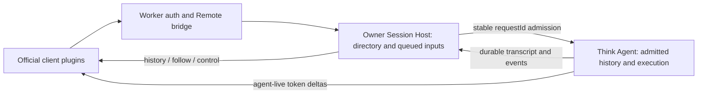

> Current differences are classified in [official differences](official-differences.en.md). The current repair pass adds real effort, per-session R2 policy, exact fork seeds, SDK step evidence, persistent authentication limits and event-driven Host observations; deployment evidence is versioned separately.

# Runtime compatibility and state ownership

Updated: 2026-11-10. The official Web UI and interaction contract remain the
product reference. Workers/Think provide a different Host and execution runtime;
matching a Remote shape does not make those execution semantics identical.
Current verification is tracked in [completion-status.md](completion-status.md).
The previous chronological notes are preserved in [history](history/2026-11-10-pre-alignment-runtime-parity.md).

## Composition and source boundary

Official code comes only from `.submodules/deepseek-harness` at the locked
release. Local capabilities live in client, Worker, Think, shared or build-only packages. Browser compatibility shims and real PDF/Excel Worker bundling belong to packages; build-only Node dependencies cannot cross into runtime packages.
The app boots generated composition; it does not own feature behavior.

- Official plugins are mounted unchanged whenever their Host contracts can be
  supplied. A compatibility seam adapts those contracts and does not copy UI.
- A fork records the official package/path/commit/license. Exported `./src/*`
  component use records exact entries and a pin-specific review commit. The settings-navigation fork changes only the section/onboarding projection to public `entriesOfSlot`, so supported shadow registrations do not duplicate navigation.
- Disabled official rows remain visible in inventory without importing their
  modules. Coverage checks validate declarations; browser acceptance separately
  checks `origin`, `replaces`, and active fibers.
- Source/export, plane, and composition validators are release gates. Negative
  fixtures verify that these gates actually fail on forbidden changes. Exact
  source counts are recorded per build in completion status. The 62 official
  UI declarations consist of 57 unchanged plugins and 5 tracked replacements.
- Public documents are selected by plugin `documentRoutes` metadata. `/login`
  starts only the login provider through the original official Loader; it skips
  private control reads, app fibers and shell mounting. Its public system-theme seam
  uses the exported official ThemePresenter and default fonts with the real
  background token; no independent dark fallback palette is supplied. The private route retains
  the full generated composition. This isolation supplements server authentication.

## Two durable authorities

The browser is a projection of durable state, not the owner of execution.

| State | Authority | Other copies |
| --- | --- | --- |
| Owner/account session | Better Auth + D1 | Worker request identity and browser session view. |
| Workspace/session directory, unadmitted input queue, settings, schedules, file metadata | Owner Session Host DO/SQLite | Official client stores and RPC/mux projections. |
| Admitted messages, running execution, tool results, execution cancellation | Owner/session Think Agent durable state | Host transcript/event journal used by official UI/history. |
| File bytes | R2 immutable objects | Version metadata in the Host DO. |
| Assistant token deltas | Agent live stream | Ephemeral browser projection; durable history is synchronized separately. |

New/forked empty Agents may be seeded from completed Host history. Existing
Agent history is never overwritten by an older Host mirror. Host transcript
replacement is atomic and retains inputs still waiting in the durable queue.
Hidden instruction/time/skill context stays durable for execution and is filtered
from the visible transcript rather than inserted as fabricated assistant output.

One admitted user request is one official Turn. An assistant/tool continuation
adds Steps inside that Turn; a tool result keeps the Step of its original call.
The shared page/follow sequencer reads transcript and request lifecycle together
from the Host snapshot. Waiting for approval is active work, not completion.
Only a recorded terminal result closes the Turn, including tool-only responses,
cancellation and failure. A completed-looking message or `running: false` is not
sufficient evidence. Imported history without an outcome remains unknown;
forked history preserves available outcomes and records an interrupted fork
boundary explicitly. The official conversation renderer remains unchanged.

Each assistant Step has a stable distinct wire identity even when the SDK stores
several `step-start` groups in one message. Forking an existing event cursor preserves that exact prefix, including cuts
before a tool starts or before its result. The unchanged official fork helper
supplies conservative missing-result and lifecycle closers. Executed model provenance comes from the actual provider
model and stays attached to history. The model control projection separately
uses the official `{lastUsed, next}` shape: durable selection supplies `next`,
while `lastUsed` comes from the executed frozen selection, independently of returned provider provenance. Selecting a
new model must not rewrite the provenance of older replies.

Execution statistics count logical requests as Turns and actual SDK step groups
as Steps. Approval continuation contributes Steps to the existing Turn. Durable
per-execution snapshots and their application markers commit atomically so hook
replay, lost responses and restarts cannot add the same statistics twice.

The bridge is not a native official execution engine. New tool-input previews and
completed SDK steps use real callback evidence and stable identities. Live,
final and reloaded step projections must agree; a fork never includes results
beyond its inherited event prefix. Imported history without precise timing or
provider evidence remains unknown. Native request logging, policy history and
full subagent behavior remain separately tracked gaps.

## Admission, interruption, and recovery

A prompt transaction records deduplication, user input, submission, and queue
events together. Browser and alarm claims use the same per-session serialization
and stable `requestId`. If the Host loses an RPC response or restarts, it reconnects
to the same admitted Think execution instead of starting a second model turn.
A fixed elapsed timeout no longer decides that an execution has failed.

Cancellation reaches Think and persists a tombstone so delayed admission cannot
revive the cancelled request. Alarm retries resume/reconcile queued work without
an open tab. These guarantees cover the tested Host/Agent handoff; they are not
an assertion of exactly-once effects in arbitrary external tools or providers. A stored BYOK credential read/decryption failure stops admission to the provider and remains retryable; only an actually unset credential and explicit deployment enablement permit platform-provider fallback. The template defaults to no platform consumption.

Archive is an admission boundary: a failed archive transaction leaves flags and targeted schedules unchanged. Once it commits, a lost cancellation response cannot reopen the session; late prompts and subsequent model/tool steps fail closed, while the Host alarm retries cancellation. The gate cannot undo a provider request or external tool effect already issued. Dynamic delegation is now unavailable: no `delegate_task` is registered, and the historical facet export preserves reads/storage while refusing model/turn/step/tool execution before provider access.

The local fault tests exercise a real Host Durable Object with a durable Agent
test double. Model/provider behavior and deployed lifecycle recovery require
the separate deployed acceptance suite.

## Storage identity and migration

`SESSION_HOST_STORAGE_ID` is `default-v49`, preserving the existing
`owner:<userId>:default-v49` namespace. `SESSION_HOST_GENERATION` is a compatibility
binding for that stable identity; its name does not authorize bumping it for a
code release. Schema evolution belongs inside the same durable object.

The owner migration path inspects legacy generations `default-v48` through
`default-v9`, validates exports and the owner-bound R2 sidecar, and commits target
rows, verification, sidecar data, and completion marker atomically. An already
populated destination is preserved. Failed import, malformed data, unavailable
source, or failed verification does not silently open an empty application:
the request returns 503 and a later request can retry idempotently. The separate
operator-token legacy anonymous-account migration is not a replacement for this
owner-generation migration.

Cloudflare can defer code updates to an active Durable Object. A new Worker
deployment therefore does not by itself prove which code an existing owner DO
is running. Deployed acceptance checks the protected Host `runtimeInfo` version
binding against `DSH_EXPECTED_DEPLOYMENT_VERSION` before making model calls;
only the previous schema/version is retried within a bounded readiness window.
Authentication, malformed data and business errors remain failures. Storage
identity is never changed to bypass the update window.

## Transport boundary

The carriers have different purposes:

- `POST /api/<endpoint>` uses official request/response envelopes for migrated
  namespaces. The Host remains the authority behind both official and custom
  routes.
- `/api/remote.mux` carries logical Session/workspace/file/tool-result streams
  and their cancellation. Host-follow implementations receive committed invalidations from the
  durable state; this is a tracked runtime difference.
- `/api/agent-live` carries real-time Agent deltas. Moving token display to Host
  polling would change latency and lifecycle semantics and is not the design.
- `POST /api/session/uploadFileBinary` uses the unchanged exported official
  raw-byte handler; `fileUploads/upload` accepts its base64 Remote counterpart.
  Both stage ordinary files in the same owner Host before atomic receipt admission.

`POST /api/session-host` remains for Host-specific operations and migration
compatibility. Official-first fallbacks only apply when an endpoint is absent;
a business rejection or uncertain transport outcome must not replay a mutation
through another route. Settings and Schedule writes preserve the official
argument shapes and return the accepted Host result or explicit failure.

## File admission and cleanup

Ordinary files are limited to 8 MiB. Each upload uses an owner-isolated physical
R2 key and a SHA-256 content identifier. The Host records a durable cleanup intent
before writing bytes, then creates a Session-bound receipt only after the complete
write. Receipt consumption, message, queue and journal event commit in one SQLite
transaction. A failed admission rolls back; a duplicate requestId returns its
original submission without permitting a second request to reuse the receipt.

Unconsumed receipts expire after 24 hours. `cleanupFiles` processes at most 50
entries per pass, continues backlogs after 5 seconds, and retries failed deletion
after 60 seconds. Metadata is removed only after R2 deletion succeeds. Admitted
history, forks and other references preserve live bytes; independent physical keys
prevent an old cleanup from deleting an equal-content new upload. Tests cover
R2/SQL failure, interrupted registration, restart and concurrent-reference windows.

Think reads admitted files from R2 with length/hash verification; it does not copy
whole files into Agent SQLite. Text previews and `read_uploaded_file` read bounded
64 KiB chunks. Binary data remains exact base64; no model-side PDF/Office parser is
configured. Separately, official browser preview uses real PDF.js and Excel
Workers, PDF font/cmap/wasm resources and FortuneSheet styles. Images are not
normalized: projections report `maxImagesPerMessage: 0`; unchanged official intake
rejects them with localized feedback, and server paths explicitly refuse them.

## Capability limits and honest UI

| Capability | Current boundary |
| --- | --- |
| Reasoning effort | The official Model / Effort menu selects real off/low/high/max values. Host selection is durable and input admission freezes the configuration; Gateway and BYOK serialize the actual request. |
| Permission presets | A marked full fork preserves the official preset algorithm, with real per-session R2 file enforcement and new-session defaults. It does not claim native process sandboxing or network confinement. |
| Tool approval | The existing approval-gated Think tool/Host continuation path is real. It does not imply that every official permission policy or tool lifecycle is implemented. |
| Terminal | No Host PTY/process service. The official plugin and exported guide/body stay visible; unavailable actions are disabled and service calls reject. |
| Account billing and feedback | Real account identity/sign-out remain available. Billing and conversation-log feedback controls are official components, visible but disabled with localized reasons; no fake balance or successful log submission is returned. |
| Session plugin inventory | The unchanged official `ui-settings-plugin-inventory` renders the official Settings “Session plugins” group from `pluginInventory.list()`: generated Cloudflare Think agent-composition rows (default) plus the four pinned declaration groups, and the real client Loader inventory in the global group. Row `fiberPhase` is null for declarations; only live client entries carry observed phases. The declaration rows use the pinned official `definitionComposition` projection; the Think inventory and runtime roster share one metadata validator. | The Host has no runnable official preset Loader, so official declaration groups are read-only inspection; no installation or execution is implied. |
| Agent presets | A complete marked fork of the official ui-agent-preset package preserves all official controllers/copy/load/Toast/animation/guides and only adapts Host availability: the four official modes stay visible in Settings and the composer in a neutral gray unavailable state with localized reasons, while true declaration-load failures keep the official red broken state; `dsh-base-think` is the canonical fixed default, and only unavailable actions (Cloudflare Think viewer, Creator while Cordis is unavailable, switching) are refused. Official ids are never aliased. |
| Plugin inventory and installation | The unchanged official manager shows the real built-in inventory read-only; `remote.pluginInventory`/`remote.pluginManager` are adaptation-seam projections with no owner-level switch. Disabled originals and deployment-owned rows remain in the official Settings built-in inventory. Add/install/upgrade/physical-uninstall return explicit unavailable reasons; no fictional installed bundle is reported. |
| Directory picker | The unchanged official browser picker consumes real logical directory RPCs. Folder creation and Workspace registration are separate durable steps. Native OS picking is unavailable. |
| Native settings document | No native editor; `hasDocument` is false and opening reports unavailable. Durable settings themselves are implemented. |
| Schedule | Durable after/at/every/daily/weekly/rrule delivery, edits, history, and alarms exist. RRULE uses the pinned official stable `dsh-util-time.RRule` implementation, with TZID, COUNT, DST and latest-due semantics. Timing edits recompute occurrences with revision checks; manual runs preserve the scheduled occurrence. Cron is supported through the pinned official Cron engine. |
| Subagent delegation and direct history | Delegation is unavailable for both BYOK and platform modes. The composition retains an honest capability statement and no delegation tool. Historical facet storage/reads remain compatible, but execution hooks reject; direct-subagent Session page/follow remains unsupported. |
| Dynamic Cordis | No isolated runtime/dynamic-worker loader for agent-defined plugin execution. The mounted UI cannot be treated as a working sandbox. |
| HMR | No Host per-plugin artifact build/graph-revision pipeline. The event carrier is not evidence of real HMR rebuild support. |
| Maintenance jobs | Cleanup/pruning/recovery jobs exist. General official job execution/details are not declared equivalent. |
| Workspace archive | SQLite atomically checks queued/running turns and active targeted schedules. Without `stopActivity`, active work returns official `workspace/session-active` details. With `true`, archive/unpin and removal of active targeted schedules commit before durable Think cancellation; alarm retries finish interrupted stops. Prompt admission and Think model/tool steps enforce the archive gate. The official descendant-lineage activity/stop lifecycle is absent; dynamic subagent execution is disabled rather than represented as cancellable supported work. |
| Tool result inspection | Journal-backed inspection can recover retained results after reload; this differs from a live-only official stream. |
| Authentication and limiter | Public signup is closed by default and its visible UI is disabled with a localized reason. A secret-header administrator path provisions isolated accounts; retired shared acceptance accounts are refused. `/login` starts no private RPC/WebSocket. Authentication HTTP limits use the persisted Better Auth D1 adapter across isolates, including restart and fail-closed storage failures. This is not a model/API quota service. |

The Schedule manager uses the official implementation. Official file preview
owns actual file rendering. The old custom Settings pages, duplicate Terminal
entry, and transcript-as-file fallback are removed. An unavailable namespace
must not be hidden, represented as a working empty feature, or accepted through
a fake successful mutation.

## Verification responsibilities

`pnpm check` validates source, types, contracts and gates. The strict type gate
checks all owned Client and Worker/Think source files plus app runtime and
Vite entries. Official Remote declarations come from the pinned generator;
compiler-emitted dependency declarations avoid merging upstream project planes.
Dependency extraction uses `noCheck`; owned source checking does not, and this
is not a claim of complete upstream semantic checking.

The current source gates include 41 validator regressions. All 76 scoped
parity/integration cases and 7 browser compatibility cases passed on the
official React 18 browser runtime. The server SDK's React peer environment is
isolated in a build dependency package; its React entrypoints cannot enter the
browser bundle. Frozen installation enforces peer contracts without exemptions.
Final full-product Worker/Chromium and deployment results are recorded in the
current ledger, including rapid input in the real conversation composer.
Local private inventory contains 108 rows with declared provenance and all enabled
fibers active. English and Chinese public login each starts one login fiber,
requests only `/api/auth-policy`, opens no WebSocket and reports no browser errors.
Neither that local run nor the controlled reference fixtures call an AI provider.
The browser compatibility cases exercise real document Workers and login policy;
they do not assert model-side document parsing.

The current ledger records the exact tested deployment and final validation
status. Deployed Host/browser/provider/file checks record their selected
origin, deployment identity and actual results. No individual gate establishes
full official UI/UX or execution parity.

## Current projection and fork boundary

Owner invalidations are emitted after successful SQL commits, coalesce for slow readers and stop on cancellation. Projection baselines and control updates use the same persisted per-session revision; they no longer use browser wall-clock values. This projection revision is separate from the dense chat cursor. It is a compatibility seam, not proof of one native event journal. Exact forks use the pinned stable `buildForkSeed`, freeze their inherited journal, exclude later results from the model transcript and continue after official closers. Permission history is not yet merged into that cursor: a fork inherits the source current effective policy. Missing prefix usage/legacy times are not invented.
